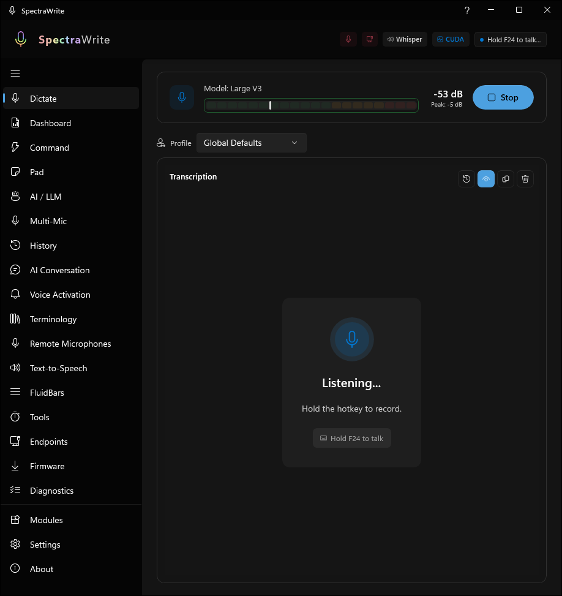
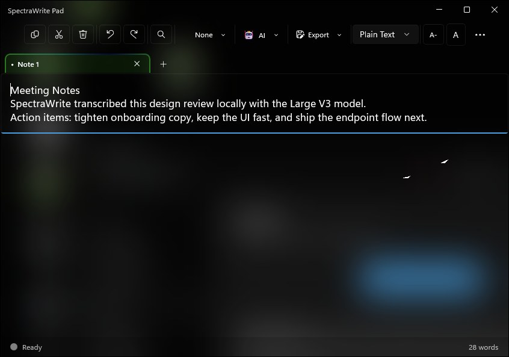
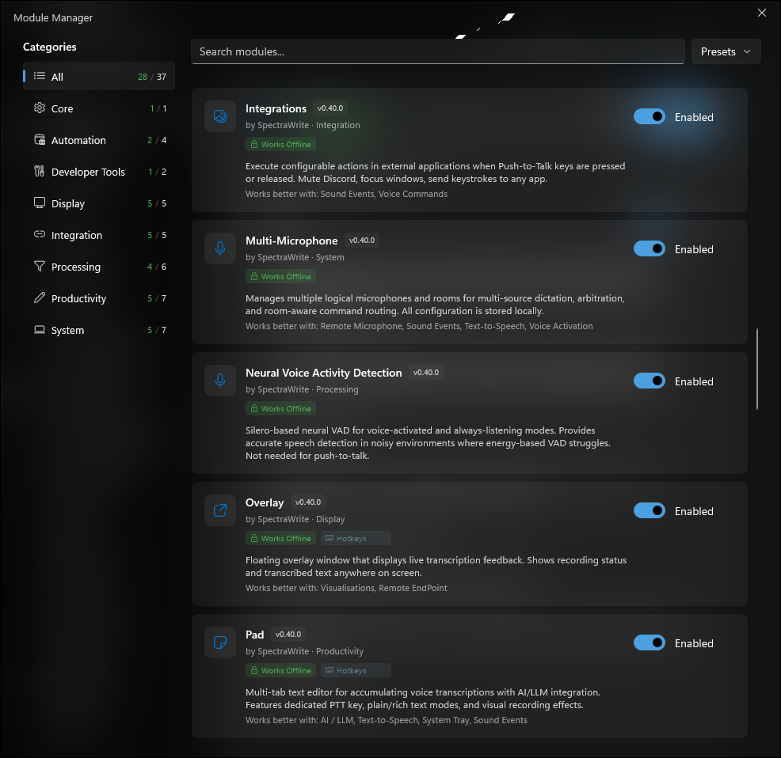
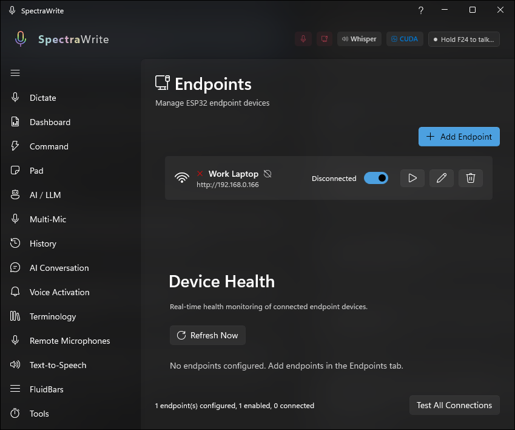

# SpectraWrite

**AI-Powered Voice Dictation for Windows — Offline-First, Privacy-Aware, Extensible**

[](https://dotnet.microsoft.com/)
[](https://www.microsoft.com/windows)
[](https://www.espressif.com/)
[](https://flutter.dev/)

---

## What is SpectraWrite?

SpectraWrite is an **offline-first, privacy-aware voice dictation system** for Windows that transcribes speech in real time using modern local AI models. By default, speech recognition runs on your device and no audio is sent to cloud services. Optional modules can download models, talk to local-network devices, or send text to configured AI providers when you explicitly enable those features. It features a modular plugin architecture with 26+ built-in modules covering everything from AI text refinement to hardware integration.

### Why Hardware Text Entry?

SpectraWrite includes an optional **hardware companion device** (ESP32-S3) called **SpectraType** that receives transcribed text and emulates a standard USB keyboard. This architecture provides unique advantages:

| Challenge | SpectraWrite + SpectraType Solution |
|-----------|-------------------------------------|
| **Air-gapped systems** | Type on machines with no network access |
| **Security-locked computers** | No software installation required on target |
| **Cross-platform compatibility** | Works on Windows, Mac, Linux — any USB-capable device |
| **KVM-free multi-PC setups** | Dictate to multiple machines without switching keyboards |
| **Legacy/embedded systems** | Voice-enable any device that accepts USB keyboards |

The target machine sees only a standard USB keyboard — completely undetectable and universally compatible.

---

## In Action

The main dictation workspace keeps the critical controls close at hand: model readiness, live audio metering, push-to-talk, and the current transcription surface are all visible in one view.



Pad gives longer-form dictation a dedicated workspace, so you can capture notes, drafts, and edits in tabs instead of sending every utterance straight into another application.



---

## Key Features

### Transcription Engines
- **Whisper** — OpenAI Whisper via Whisper.net, multiple model sizes (Tiny to Large V3 Turbo), runs 100% locally
- **Parakeet** — NVIDIA Parakeet TDT ASR via sherpa-onnx, excellent accuracy for English and 25+ European languages
- **GPU acceleration** — CUDA (Whisper) and DirectML (Parakeet) for real-time performance
- **Unified Model Manager** — browse, download, and manage models for all backends from one place
- **Engine Comparison** — side-by-side comparison tool to evaluate accuracy, speed, and quality between engines

### Audio & Input
- **Push-to-Talk** with configurable global hotkeys
- **Voice Activity Detection (VAD)** — Silero neural VAD for hands-free and always-listening modes
- **Audio processing pipeline** — compression, noise gate, de-esser, high-pass filter, normalisation
- **Remote Microphone** — wireless audio input from ESP32 and Android devices over WiFi
- **Multi-language support** with auto-detection

### Text Processing
- **Voice Replacements** — spoken trigger phrases mapped to text (e.g., "new line" → line break, "question mark" → ?)
- **Voice Commands** — control your computer with voice: launch apps, execute shortcuts, create macros, automate workflows
- **Domain Terminology** — automatic correction of technical terms for consistent casing and formatting
- **AI / LLM integration** — Ollama-powered text refinement, grammar correction, and formatting
- **Prompt Builder** — structured prompt editor with section management, templates, validation, and token counting

### Output & Productivity
- **Local typing** — transcribed text typed directly into the active application
- **Pad** — multi-tab text editor for accumulating transcriptions with AI integration, dedicated PTT key, rich text support
- **Quick Dictate** — floating dictation window for fast voice-to-text input to any application
- **Text-to-Speech** — offline TTS synthesis via sherpa-onnx for reading back transcriptions, AI responses, and alerts
- **Hardware endpoints** — send transcriptions to ESP32/Raspberry Pi devices for USB HID typing on remote machines

### User Interface
- **Modern WinUI 3** with customisable Acrylic transparency effects
- **Horizontal bar mode** — compact layout toggled with F11 for minimal screen footprint
- **Floating overlay** — live transcription feedback visible on top of any application
- **Recording indicator** — customisable floating indicator with VU meter and pulse animation modes
- **Audio visualisations** — waveform and spectrogram displays with real-time visual feedback
- **Visual effects** — animated background effects across weather, space, hypnotic, nature, abstract, and retro categories
- **System tray** — minimise to tray with quick access context menu
- **Sound events** — configurable auditory feedback for recording, transcription, errors, and more
- **Settings search** — find any setting instantly with live search and control highlighting
- **Smooth animations** — spring-based UI animations (disablable for accessibility)

### Analytics & Diagnostics
- **Dashboard** — local usage statistics with transcription patterns, word counts, and session history
- **Diagnostics** — real-time performance monitoring, audio buffer statistics, and transcription metrics
- **Error reporting** — friendly error handler with optional (never automatic) diagnostic report submission

### Privacy & Security
- **Offline by default** — core dictation works without cloud services
- **Optional network features** — model downloads, local-network integrations, and cloud AI providers are opt-in
- **No automatic telemetry** — diagnostic submission is user-initiated only
- **HMAC-SHA256 authentication** for hardware communication
- **Configurable passkeys** for remote device trust

### Hardware Integration (SpectraType)
- **WiFi & Bluetooth connectivity** — station mode, AP mode, or BLE
- **USB HID keyboard emulation** — universal compatibility
- **Three typing modes** — instant, natural (human-like), typewriter
- **Optional OLED display** — real-time status and progress
- **Multiple simultaneous endpoints** — type on several machines at once

### Mobile Companion (SpectraWrite Mic)
- **Flutter app** for Android — use your phone as a wireless microphone
- **WiFi streaming** — audio streamed to SpectraWrite for transcription

---

## System Requirements

### Windows Application

| Component | Minimum | Recommended |
|-----------|---------|-------------|
| **OS** | Windows 10 21H1 (64-bit) | Windows 11 |
| **CPU** | Intel Core i5 / Ryzen 5 | Intel Core i7 / Ryzen 7 |
| **RAM** | 8 GB | 16 GB |
| **Storage** | 4 GB (for models) | SSD recommended |
| **GPU** | — | NVIDIA RTX 2060+ (CUDA) or DirectML-capable GPU |

### Hardware Device (Optional)

| Component | Specification |
|-----------|---------------|
| **Board** | ESP32-S3-DevKitC-1 (recommended) |
| **Alternatives** | Waveshare ESP32-S3-Zero, Seeed XIAO ESP32S3 |
| **USB** | Native USB OTG (HID capable) |
| **Connectivity** | WiFi 802.11 b/g/n, Bluetooth 5.0 |
| **Cost** | ~$10 USD |

> **Important**: Original ESP32 boards (non-S2/S3) do **not** have native USB support and cannot function as USB HID keyboards.

---

## Quick Start

### 1. Install the Windows Application

1. Download the latest release from the [Releases page](https://github.com/BootBlock/SpectraWrite/releases)
2. Run the x64 installer or extract the x64 portable ZIP
3. Launch **SpectraWrite**
4. On first run, select and download a transcription model via the Model Manager

> **Trust note**: Release artifacts are currently intentionally unsigned. Windows may show SmartScreen or reputation prompts the first time you run the installer or app.

> **Architecture note**: Public v1 release artifacts are x64-only.

For detailed installation instructions, see the [Installation Guide](docs/guides/endpoint/spectrawrite-setup.md).

### 2. Start Dictating (Software-Only Mode)

1. Click **Start** or press your Push-to-Talk hotkey (default: `Right Control`)
2. Speak naturally into your microphone
3. Watch your words appear in real-time
4. Release the hotkey to stop dictation

The transcribed text is automatically typed into the active application.

### 3. Hardware Setup (Optional — For Remote Typing)

To enable typing on a separate machine:

1. **Flash your ESP32-S3** with the SpectraType firmware
2. **Configure WiFi** on the device via the web portal
3. **Add the endpoint** in SpectraWrite Settings → Modules → Remote EndPoints
4. **Connect the ESP32** to your target machine via USB
5. **Start dictating** — text flows: Your PC → WiFi → ESP32 → USB Keyboard → Target Machine

For step-by-step hardware setup, see the [Quick Start Guide](docs/guides/endpoint/quick-start.md).

---

## Network & Scope

### Network Ports (SpectraType Hardware)

| Port | Protocol | Direction | Purpose |
|------|----------|-----------|---------|
| **80** | HTTP | PC → Device | Primary communication — typing requests, status, configuration portal |
| **80** | WebSocket | PC ↔ Device | Real-time event streaming (at `/ws` path) |
| **443** | HTTPS | PC → Device | Encrypted alternative to port 80 (requires TLS certificates) |
| **4210** | UDP | PC → Device | Optional low-latency fast path (2–8 ms) |
| **8989** | HTTP | Device → PC | Remote Microphone audio streaming (separate module) |

Port 80 is the standard HTTP port — no port suffix is needed in the Server URL (e.g., `http://192.168.1.42`).

### Privacy posture

- **Default behavior**: Speech recognition, local typing, and core dictation flows run locally.
- **Optional internet use**: Model downloads, update checks, and cloud AI providers can use the internet when enabled.
- **Optional local-network use**: Remote EndPoint and Remote Microphone communicate with devices on your LAN.
- **Optional Bluetooth use**: Remote EndPoint can use Bluetooth transports when configured.

The application UI mirrors this with **Works Offline**, **Internet**, **Local Network**, **Bluetooth**, and **Analytics** badges in setup and module management surfaces. **Works Offline** means the module's core tasks do not require internet access; optional downloads or LAN/Bluetooth integrations are disclosed separately by the other badges.

### Public v1 scope

Unless marked otherwise, built-in modules are part of the supported public v1 surface.

- **Experimental in public v1**: Voice Commands, Voice Activation
- **Feature-level experimental items still called out in-product**: Whisper streaming mode and selected advanced visual styles

Experimental modules are included for evaluation, but they are outside the polished v1 support bar and may change more aggressively.

### Trust docs

- [PRIVACY.md](PRIVACY.md) — repo-level privacy and network summary
- [SECURITY.md](SECURITY.md) — vulnerability reporting and security notes
- [SUPPORT.md](SUPPORT.md) — support boundaries and troubleshooting paths
- [CHANGELOG.md](CHANGELOG.md) — release notes and scope notes

---

## Modules

SpectraWrite ships with 26+ built-in modules. All modules are optional and can be enabled or disabled individually.

The Module Manager groups modules by category so you can scan capabilities, dependencies, and enablement state without digging through settings pages.



### Transcription Engines

| Module | Description |
|--------|-------------|
| **Whisper** | Whisper.net backend with CUDA GPU acceleration, models from Tiny to Large V3 Turbo |
| **Parakeet** | NVIDIA Parakeet TDT ASR via sherpa-onnx with DirectML acceleration |
| **Model Manager** | Unified model browsing, downloading, and management for all backends |

### Processing & Text Pipeline

| Module | Description |
|--------|-------------|
| **AI / LLM** | Multi-provider AI text processing via Ollama, OpenAI-compatible APIs, and Anthropic Claude |
| **Audio Processing** | Compression, noise gate, de-esser, high-pass filter, normalisation |
| **Neural VAD** | Silero-based neural voice activity detection for hands-free modes |
| **Voice Replacements** | Spoken trigger phrases mapped to text substitutions |
| **Domain Terminology** | Automatic domain-specific term correction |
| **Voice Commands** | Voice-controlled app launching, shortcuts, macros, and workflows |

### Productivity

| Module | Description |
|--------|-------------|
| **Pad** | Multi-tab text editor with AI integration and dedicated PTT key |
| **Prompt Builder** | Structured prompt editor with templates, validation, and token counting |
| **Quick Dictate** | Floating dictation window for fast voice-to-text input |
| **Text-to-Speech** | Offline TTS synthesis via sherpa-onnx |

### Display & Visual

| Module | Description |
|--------|-------------|
| **Overlay** | Floating window showing live transcription feedback |
| **Indicator** | Recording status indicator with VU meter and pulse animation |
| **Visualisations** | Waveform and spectrogram audio displays |
| **Visual Effects** | Animated background effects (weather, space, nature, retro, etc.) |
| **Animations** | Smooth spring-based UI animations |

### Analytics & System

| Module | Description |
|--------|-------------|
| **Dashboard** | Local usage statistics and session history |
| **Diagnostics** | Real-time performance monitoring and transcription metrics |
| **Engine Comparison** | Side-by-side transcription engine evaluation |
| **Error Reporting** | Friendly error handling with optional diagnostic reports |
| **Sound Events** | Configurable auditory feedback for application events |
| **System Tray** | System tray icon with quick access context menu |

### Integration & Hardware

| Module | Description |
|--------|-------------|
| **Remote EndPoint** | Send transcriptions to ESP32/Raspberry Pi devices via WiFi or Bluetooth |
| **Remote Microphone** | Wireless audio input from ESP32 and Android devices |

The Endpoints tab gives Remote EndPoint a dedicated control surface for adding devices, checking connection state, and watching health status before you route dictation off-machine.



> Modules marked **Experimental** in the app are shipped in the public build, but they are not treated as part of the polished v1 support bar.

---

## Documentation

### Getting Started

| Guide | Description |
|-------|-------------|
| [Quick Start](docs/guides/endpoint/quick-start.md) | Get the full system running |
| [SpectraWrite Setup](docs/guides/endpoint/spectrawrite-setup.md) | Configure endpoints in the app |

### Hardware Guides (SpectraType)

| Guide | Description |
|-------|-------------|
| [ESP32 Flashing Guide](docs/guides/endpoint/esp32-flashing.md) | Flash SpectraType firmware to your device |
| [ESP32 Firmware Guide](docs/guides/endpoint/esp32-firmware.md) | Complete firmware documentation |
| [OLED Display Setup](docs/guides/endpoint/oled-display.md) | Add an optional status display |
| [Troubleshooting](docs/guides/endpoint/esp32-troubleshooting.md) | Common issues and solutions |

### Remote Microphone Guides

| Guide | Description |
|-------|-------------|
| [Remote Mic Overview](docs/guides/remote-mic/README.md) | Remote microphone system overview |
| [Remote Mic Quick Start](docs/guides/remote-mic/quick-start.md) | Set up wireless audio input |
| [ESP32 Mic Setup](docs/guides/remote-mic/esp32-setup.md) | Configure ESP32 as a remote microphone |
| [Flutter App Guide](docs/guides/remote-mic/flutter-app.md) | Android companion app documentation |
| [Remote Mic Architecture](docs/guides/remote-mic/architecture.md) | System architecture details |
| [Remote Mic Troubleshooting](docs/guides/remote-mic/troubleshooting.md) | Common issues and solutions |

### Reference

| Document | Description |
|----------|-------------|
| [EndPoint Protocol Specification](docs/guides/endpoint/protocol-specification.md) | Complete HTTP API reference for SpectraType |
| [EndPoint Security Guide](docs/guides/endpoint/security-guide.md) | Authentication and best practices |
| [EndPoint Network Configuration](docs/guides/endpoint/network-configuration.md) | WiFi, AP Mode, and Bluetooth setup |
| [Remote Mic Protocol](docs/guides/remote-mic/protocol-specification.md) | Remote microphone protocol reference |
| [Remote Mic Security](docs/guides/remote-mic/security.md) | Remote microphone security guide |

### Developer Guides

| Document | Description |
|----------|-------------|
| [Module Development Guide](docs/MODULE-DEV-GUIDE.md) | Create custom modules for SpectraWrite |
| [Module API Reference](docs/MODULE-API.md) | Complete module API documentation |

---

## Architecture

```
┌─────────────────────────────────────────────────────────────────────────────┐
│                           YOUR WORKSTATION                                  │
│  ┌─────────────────────────────────────────────────────────────────────┐    │
│  │                      SpectraWrite (Windows)                         │    │
│  │  ┌───────────┐   ┌──────────────┐   ┌──────────────┐               │    │
│  │  │ Microphone│──▶│ Audio Capture│──▶│  Whisper /   │               │    │
│  │  │    🎤     │   │   (NAudio)   │   │  Parakeet    │               │    │
│  │  └───────────┘   └──────────────┘   └──────┬───────┘               │    │
│  │                                            │                        │    │
│  │  ┌───────────┐   ┌──────────────┐          │                        │    │
│  │  │  Remote   │──▶│ Audio Proc.  │──────────┘                        │    │
│  │  │   Mic 📱  │   │  Pipeline    │                                   │    │
│  │  └───────────┘   └──────────────┘                                   │    │
│  │                                    ┌──────────────┐                 │    │
│  │                                    │ Transcribed  │                 │    │
│  │                                    │    Text      │                 │    │
│  │                                    └──────┬───────┘                 │    │
│  │                                           │                         │    │
│  │              ┌────────────────────────────┼────────────────────┐    │    │
│  │              │                            │                    │    │    │
│  │              ▼                            ▼                    ▼    │    │
│  │   ┌──────────────────┐        ┌────────────────┐    ┌─────────────┐│    │
│  │   │   Local Typing   │        │  WiFi/HTTP to  │    │  Pad / Quick││    │
│  │   │  (This Machine)  │        │  SpectraType   │    │   Dictate   ││    │
│  │   └──────────────────┘        └───────┬────────┘    └─────────────┘│    │
│  │                                       │                             │    │
│  └───────────────────────────────────────┼─────────────────────────────┘    │
│                                          │                                  │
└──────────────────────────────────────────┼──────────────────────────────────┘
                                           │
                                           │ WiFi / Bluetooth
                                           │ (HTTP/JSON)
                                           ▼
                               ┌───────────────────────┐
                               │   SpectraType Device  │
                               │      (ESP32-S3)       │
                               │  ┌─────────────────┐  │
                               │  │ HTTP Server     │  │
                               │  │ Request Queue   │  │
                               │  │ Typing Engine   │  │
                               │  │ USB HID Driver  │  │
                               │  └─────────────────┘  │
                               └───────────┬───────────┘
                                           │ USB Cable
                                           │ (Appears as Keyboard)
                                           ▼
                               ┌───────────────────────┐
                               │    TARGET MACHINE     │
                               │  • Any OS (Win/Mac/   │
                               │    Linux/Embedded)    │
                               │  • No software needed │
                               │  • Air-gapped OK      │
                               └───────────────────────┘
```

---

## Building from Source

### Prerequisites

- **Visual Studio 2022** (17.8+) with:
  - .NET 10 SDK
  - Windows App SDK
  - C++ build tools (for native dependencies)
- **Git**
- **(Optional)** NVIDIA CUDA Toolkit 13+ for GPU acceleration
- **(Optional)** PlatformIO for ESP32 firmware
- **(Optional)** Flutter SDK for the mobile companion app

### Build the Windows Application

```bash
git clone https://github.com/BootBlock/SpectraWrite.git
cd SpectraWrite
dotnet restore
dotnet build -c Release
```

The application builds to `!Distribution/` with a flat structure.

### Build the ESP32 Firmware

```bash
cd tools/esp32-spectrawrite

# Choose your board
pio run -e esp32s3-devkitc -t upload    # DevKitC-1
pio run -e esp32s3-zero -t upload       # ESP32-S3-Zero
pio run -e xiao-esp32s3 -t upload       # XIAO ESP32S3
```

For detailed build instructions, see the [ESP32 Firmware Guide](docs/guides/endpoint/esp32-firmware.md).

### Build the Mobile Companion App

```bash
cd tools/spectrawrite-mic
flutter pub get
flutter build apk
```

---

## Project Structure

```
SpectraWrite/
├── src/                          # Windows application source
│   ├── SpectraWrite.UI/          # WinUI 3 application
│   ├── SpectraWrite.Audio/       # Audio capture (NAudio)
│   ├── SpectraWrite.Core/        # Core abstractions and models
│   ├── SpectraWrite.Input/       # Keyboard simulation and hotkeys
│   ├── SpectraWrite.Pipeline/    # Text processing pipeline
│   ├── SpectraWrite.Configuration/ # Settings management
│   ├── SpectraWrite.Modules.Abstractions/ # Module interfaces
│   ├── SpectraWrite.Modules.Loader/       # Dynamic module loader
│   └── ...                       # Other libraries
├── modules/                      # Plugin modules (26+)
│   ├── Module.TranscriptionWhisper/  # Whisper engine
│   ├── Module.TranscriptionParakeet/ # Parakeet engine
│   ├── Module.AiLlm/            # Ollama AI integration
│   ├── Module.Pad/              # Multi-tab text editor
│   ├── Module.VoiceCommands/    # Voice command system
│   ├── Module.EndPoint/         # Remote hardware endpoints
│   ├── Module.RemoteMic/        # Remote microphone input
│   └── ...                      # Other modules
├── tools/
│   ├── esp32-spectrawrite/      # ESP32 SpectraType firmware
│   └── spectrawrite-mic/        # Flutter mobile companion app
├── docs/                        # Documentation
│   ├── guides/endpoint/         # Hardware setup guides
│   ├── guides/remote-mic/       # Remote microphone guides
│   ├── MODULE-DEV-GUIDE.md      # Module development guide
│   └── MODULE-API.md            # Module API reference
├── tests/                       # Unit and UI tests
└── schemas/                     # JSON schemas for modules and settings
```

---

## Contributing

SpectraWrite is not open for source code contributions. However, the application is built on a **modular plugin architecture** and contributions in the form of **custom modules** are welcome.

If you'd like to extend SpectraWrite's functionality, see the [Module Development Guide](docs/MODULE-DEV-GUIDE.md) and the [Module API Reference](docs/MODULE-API.md) to get started building your own modules.

---

## Acknowledgements

- [Whisper.net](https://github.com/sandrohanea/whisper.net) — .NET bindings for OpenAI Whisper
- [sherpa-onnx](https://github.com/k2-fsa/sherpa-onnx) — NVIDIA Parakeet ASR and text-to-speech
- [NAudio](https://github.com/naudio/NAudio) — Audio capture library
- [Windows App SDK](https://github.com/microsoft/WindowsAppSDK) — Modern Windows UI framework
- [Ollama](https://ollama.com/) — Local LLM runtime
- [Silero VAD](https://github.com/snakers4/silero-vad) — Neural voice activity detection
- [ESP-IDF](https://github.com/espressif/esp-idf) & [Arduino-ESP32](https://github.com/espressif/arduino-esp32) — ESP32 development
- [TinyUSB](https://github.com/hathach/tinyusb) — USB HID implementation

---

<div align="center">

**[Documentation](docs/guides/endpoint/README.md)** · **[Report Bug](https://github.com/BootBlock/SpectraWrite/issues)** · **[Request Feature](https://github.com/BootBlock/SpectraWrite/issues)**

</div>
